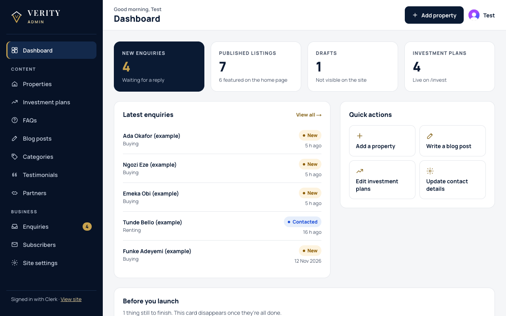
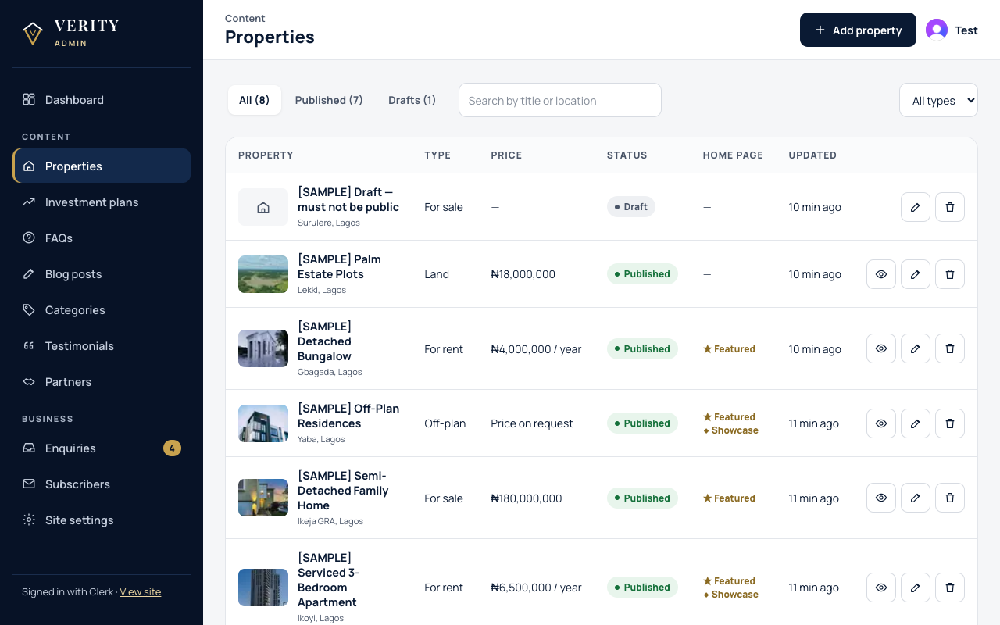
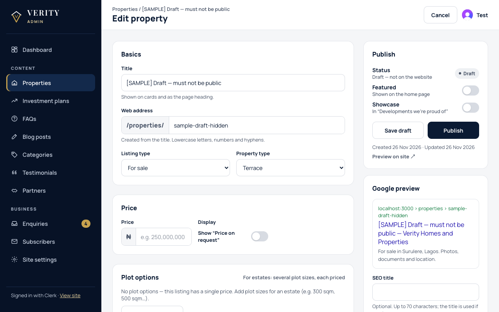
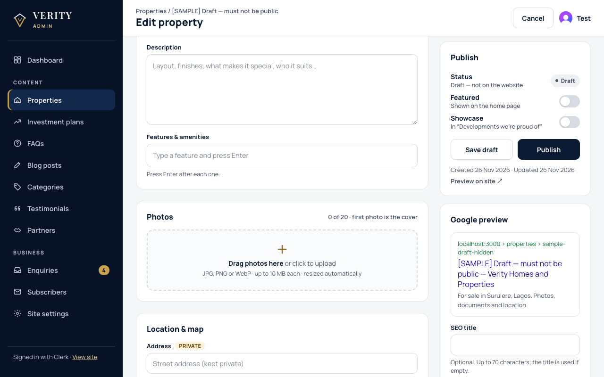
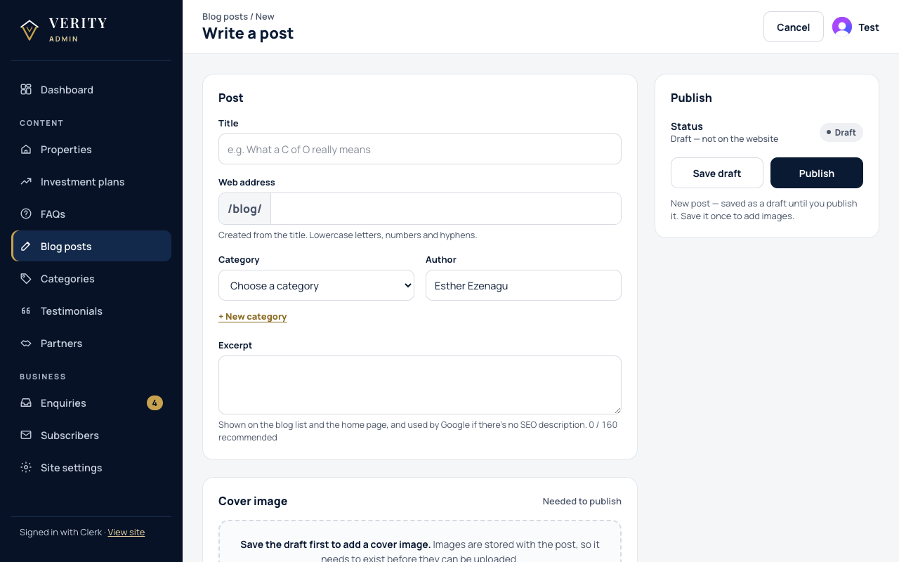
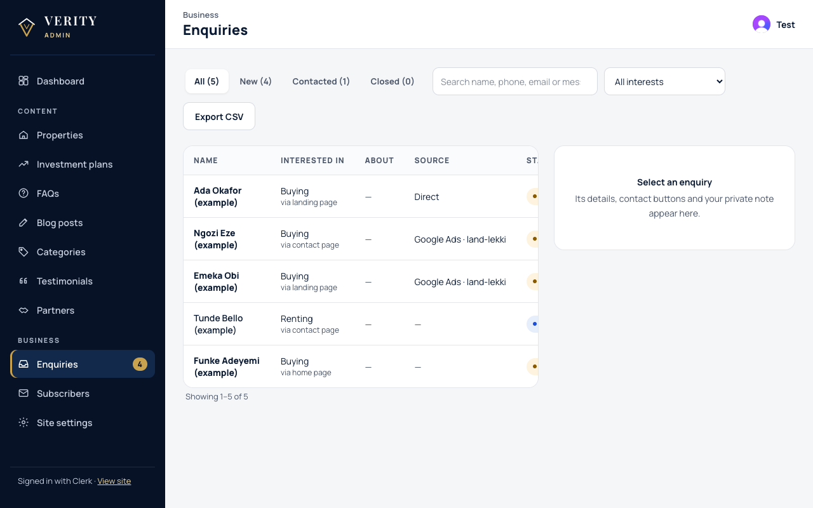
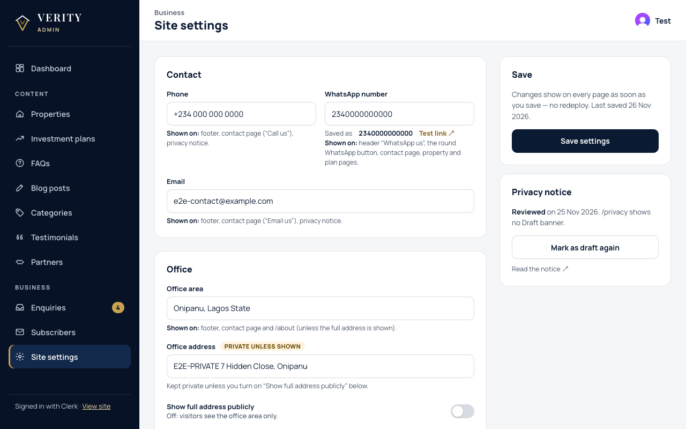

# Verity website: admin guide

For Esther and anyone who updates www.verityhomes.ng. Short sections; read the one you need.
The screenshots use sample data and example names.

**The golden rules**

- Nothing appears on the website until you press **Publish**. Drafts are private.
- After you publish or save, the public page updates within a few seconds. If it doesn't,
  refresh the page.
- When in doubt, press **Preview** or open the page on your phone before telling people about it.

---

## 1. Signing in

1. Go to **www.verityhomes.ng/admin**.
2. Sign in with your email and password (or the code Clerk emails you).
3. You land on the **Dashboard**: new enquiries, a checklist of things still to do, and quick
   buttons for common jobs.

If it says **"You don't have access"**, your account isn't set up as an admin yet. Ask your
web developer to add the admin role to your account.

The menu on the left (a ☰ button on your phone) has everything: **Properties, Investment
plans, FAQs, Blog posts, Categories, Testimonials, Partners, Enquiries, Subscribers, Site
settings**.

---

## 2. Adding a property

**Properties**, then **Add property**. The page is split into panels; fill them from top to
bottom.

| Panel | What to enter |
| --- | --- |
| **Basics** | Title (e.g. "4-Bedroom Detached Duplex"), listing type (sale, rent, land, off-plan), property type, the description |
| **Price** | The price in naira, or tick **Price on request** |
| **Plot options** | For land/estates with several plot sizes: one line per plot with its size, price and deposit |
| **Development & offer** | Developer name, payment plan, offer end date (only if they apply) |
| **Details** | Bedrooms, bathrooms, size, title document (C of O, Governor's Consent…), features |
| **Photos** | See below |
| **Location & map** | Area (e.g. Lekki), city, the private address and the map pin |
| **Documents** | The documents the property has (names only, e.g. "Survey plan") |

**Photos**

- Drag photos onto the box, or tap it to choose them. Up to **20 photos**.
- The **first photo is the cover**: it shows on cards and at the top of the page. Drag photos
  to change the order.
- Use bright, sharp, landscape photos. No watermarks from other agents.
- If an upload fails, try again; if it keeps failing, tell your web developer.

**The map and the address**

- The **address** is private: it is never shown on the website.
- The map pin shows the area. Only turn on **Show exact location on the map** if the owner is
  happy for the exact spot to be public. Otherwise the map shows the area only.

**Publish checklist** (the **Publish** panel won't let you publish without the first three)

- [ ] A title.
- [ ] The area (e.g. Lekki).
- [ ] A price, or **Price on request**.
- [ ] At least one good photo (the cover).
- [ ] Title document checked, and the description has no promises you can't keep.
- [ ] Look at the **Google preview** panel: this is how the listing appears in Google search.

Then press **Publish**. To take a property off the website later, press **Unpublish**. It
goes back to being a draft and you can publish it again any time.

Every area with at least one published property automatically gets its own page (e.g.
`/properties/in/lekki`).

---

## 3. Blog posts

**Blog posts**, then **New post**.

1. Write the post, or paste the draft from the AI tool. The prompt to use is in
   `docs/AI-BLOG-PROMPT.md` (the owner will add it).
2. Add a **cover photo** and its description (what the photo shows).
3. Choose a **category**.
4. Press **Preview** and read the whole post there before publishing.
5. **Publish.**

**How headings and bullets work.** The post box uses simple symbols:

| Type this | You get |
| --- | --- |
| `## Check the title document` (two # and a space, on its own line) | A heading |
| `- Pay into a company account` (a dash and a space) | A bullet point |
| `**important**` | **bold** |
| A blank line between paragraphs | A new paragraph |

Always check **Preview**: if you see `##` or `-` on the preview, a space is missing after the
symbol. When pasting from ChatGPT or Word, headings sometimes arrive as plain lines. Add `## `
in front of them.

Never publish facts you haven't checked (prices, laws, figures). If the AI draft includes
`[CHECK]`, look it up or remove it before publishing.

---

## 4. Enquiries: where your leads are

**Enquiries** lists every message sent from the website, newest first. You also get an email
for each one.

- Tabs: **All, New, Contacted, Closed**. Click an enquiry to open it.
- The **WhatsApp** button opens WhatsApp with a greeting ready to send.
- Mark it **Contacted** when you've replied and **Closed** when it's finished, so the **New**
  tab only shows what still needs attention.
- **Private note**: only admins can see it (e.g. "Called, inspection Saturday").

**Where did this lead come from?** The **Source** column tells you how the person found the
website:

| Source shows | Meaning |
| --- | --- |
| `Google Ads · land-lekki` | Clicked a Google ad; `land-lekki` is the campaign name |
| `Instagram Ads · december` | Clicked an Instagram ad in the "december" campaign |
| `Instagram` / `Facebook` | Came from a normal (not paid) post or link |
| `Google search` | Found you on Google, not through an ad |
| `Direct` | Typed the address or used a bookmark |
| `—` | An older enquiry, from before tracking started |

The **Form** line in an enquiry says which form they used (property page, contact page,
landing page…).

**Download as a spreadsheet:** **Export CSV** downloads the enquiries you are looking at
(the current tab, search and filter), with the Source, campaign and landing page in columns.
Open it in Excel or Google Sheets.

---

## 5. Investment plans

**Investment plans** is where the plans on the **Invest** page are managed.

- **Keep plans as drafts (unpublished) until the lawyer has reviewed the wording.** Plans show
  returns and terms; they must be approved before they appear on the website.
- When approved: check every figure against the signed agreement, then **Publish**.
- **FAQs** (in the menu) are the questions shown on the Invest page.

---

## 6. Testimonials and partners

- **Testimonials**: only publish a testimonial if the client **gave written permission**. Tick
  "The client gave written permission to publish this". Publishing is blocked until you do.
  Keep the permission (message or email) somewhere safe.
- **Partners**: only show a company's logo if you **have permission to display it**. The same
  tick is required.

---

## 7. Site settings

**Site settings** controls the details shown all over the website:

- **Contact**: phone, WhatsApp number, email. These appear in the header, footer, contact page
  and every WhatsApp button. *(The email currently shows `into@verityhomes.ng`. Please check
  it should be `info@`.)*
- **Office**: the area shown publicly and the map. The full street address only shows if you
  tick **Show full address publicly**.
- **Company**: name, RC number, opening hours.
- **Social media**: links to your Instagram, Facebook, etc. (only filled ones show).
- **Website text**: Esther's bio and promise, and the company story (About page).
- **Privacy**: once a lawyer has reviewed the privacy policy, press **Mark privacy notice as
  reviewed**.

Press **Save** at the bottom.

---

## 8. Getting more clients

The website brings in leads; these habits bring in more.

1. **Google Business Profile.** Create or claim "Verity Homes and Properties" at
   business.google.com, with the office in Onipanu, phone, opening hours, photos and the website
   link. This is what shows on Google Maps and the right side of Google search.
2. **Ask every happy client for a Google review.** Send them the "Ask for reviews" link from
   your Business Profile on WhatsApp right after a successful deal. Reply to every review,
   good or bad.
3. **Post 1–2 blog articles a week.** Answer the questions clients actually ask you ("How do I
   check a C of O?", "What fees do I pay when renting?"). Each post is a new way for people to
   find you on Google.
4. **Keep listings fresh.** Unpublish anything sold or let the same day. Add new listings with
   good photos. Stale listings lose trust.
5. **Use the landing pages for ads.** Point ads at the matching page and add a campaign tag, so
   the enquiry's **Source** tells you which ad worked:

   | Ad | Link to use |
   | --- | --- |
   | Google ad for land | `https://www.verityhomes.ng/land-for-sale-lagos?utm_source=google&utm_medium=cpc&utm_campaign=land-lekki` |
   | Instagram ad for rentals | `https://www.verityhomes.ng/rent-apartment-lagos?utm_source=instagram&utm_medium=paid_social&utm_campaign=december` |
   | Facebook ad for buying | `https://www.verityhomes.ng/buy-house-lagos?utm_source=facebook&utm_medium=paid_social&utm_campaign=homes-jan` |

   Change only the `utm_campaign=` part to name each campaign (no spaces). Google Ads also tags
   links automatically, so they show as "Google Ads" even without the tags.
6. **See leads per ad.** In **Enquiries**, look at the **Source** column, or **Export CSV** and
   sort by the Source / Campaign columns to count enquiries per campaign. Compare that with
   what each campaign cost.
